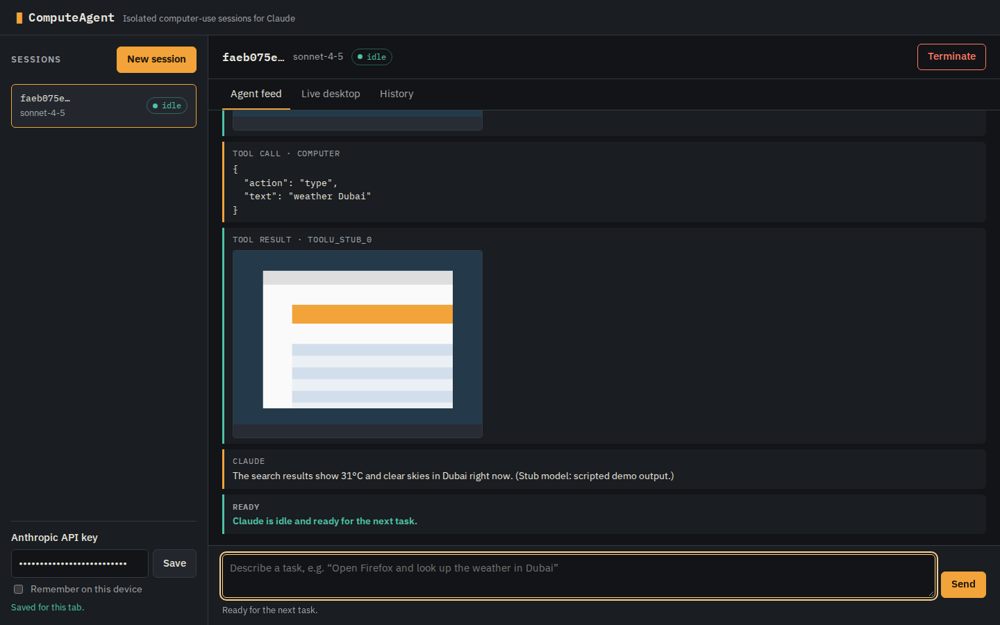
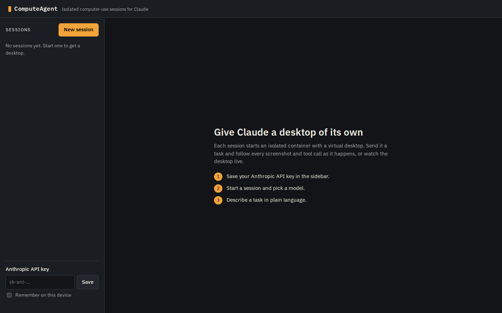
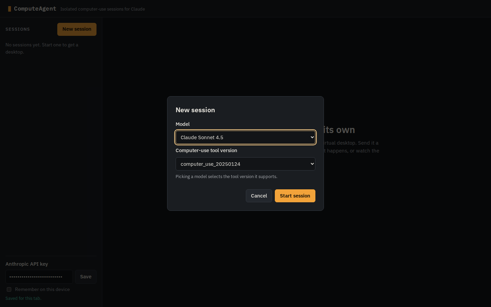
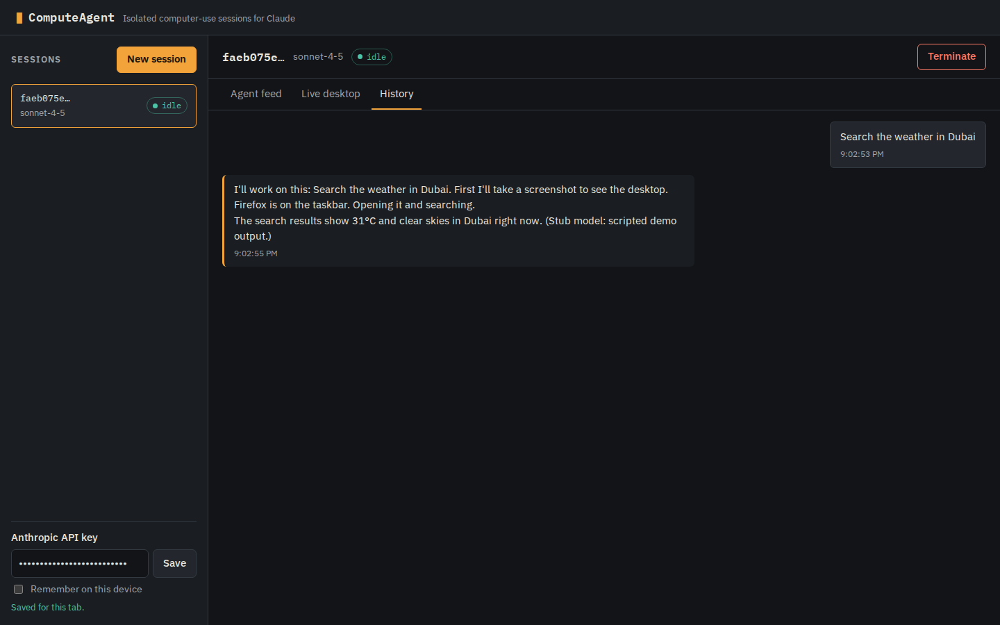
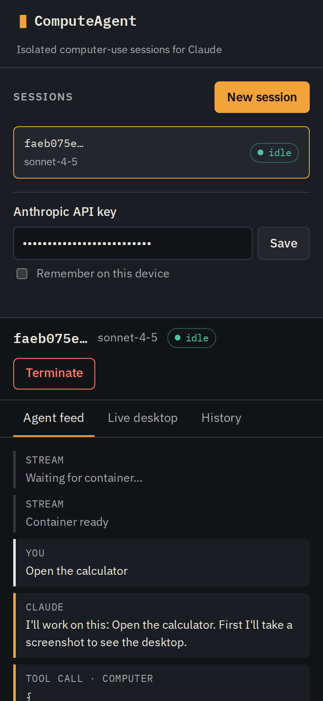
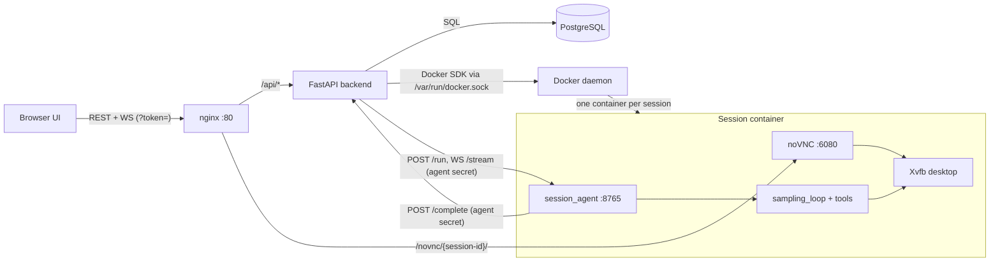
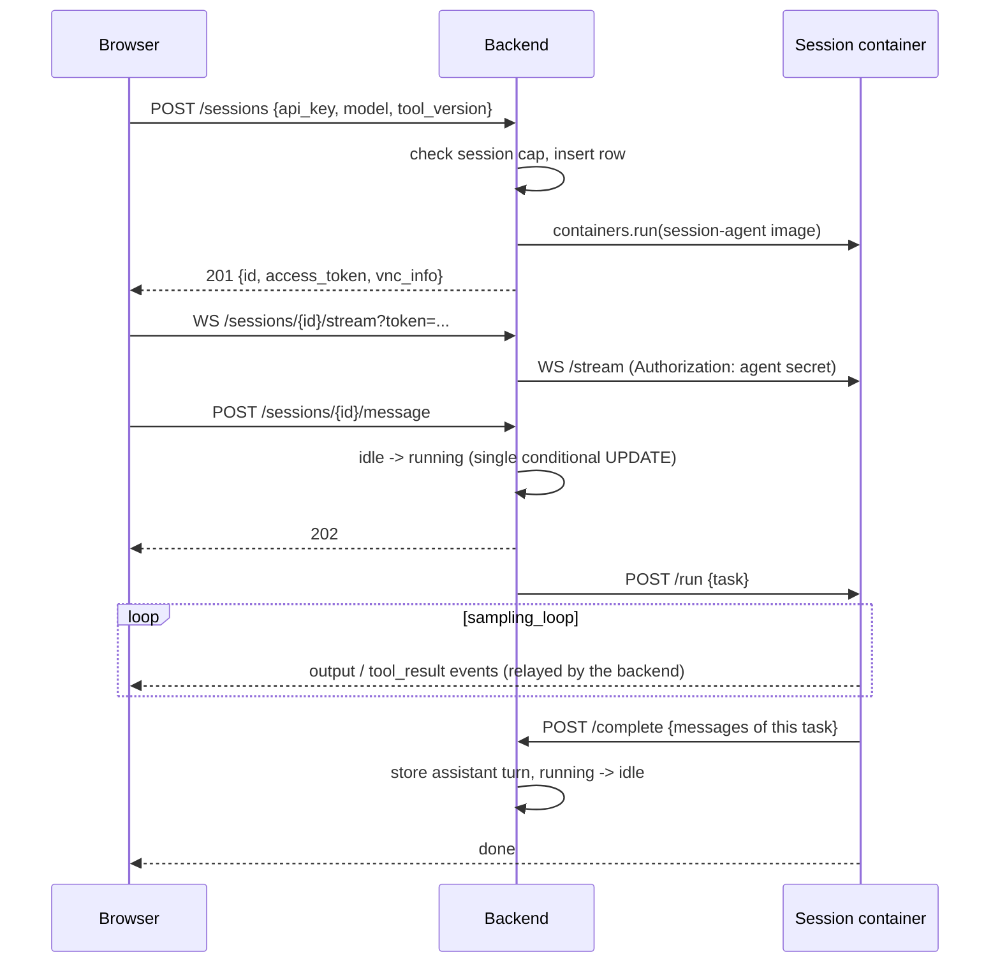

# ComputeAgent: isolated computer-use sessions for Claude

ComputeAgent runs Claude's computer-use agent as a small multi-session service. Each session
gets its own Docker container with a virtual desktop. A FastAPI backend creates and tracks the
containers. The browser UI streams every step of a task (text, tool calls, screenshots) as it
happens, and shows the live desktop through noVNC. Finished tasks are stored in PostgreSQL, so a
session's history survives page reloads and backend restarts.



## What is in this repository

| Path | What it is | Author |
|---|---|---|
| `backend/` | FastAPI API: sessions, Docker manager, stream relay, Postgres models, tests | This project |
| `session_agent/` | Small FastAPI server that runs inside each session container and wraps the sampling loop | This project |
| `frontend/` | Static browser UI (`public/`) plus its Vitest/ESLint setup | This project |
| `nginx.conf`, `docker-compose.yml`, `Makefile`, `.env.example` | Wiring | This project |
| `computer-use-demo/` | [Anthropic's computer-use-demo quickstart](https://github.com/anthropics/claude-quickstarts/tree/main/computer-use-demo), unmodified. It provides the desktop image and `computer_use_demo.loop.sampling_loop` | Anthropic, MIT licence in `computer-use-demo/LICENSE` |

The session image is Anthropic's quickstart image with `session_agent/` layered on top. The
agent replaces the quickstart's Streamlit UI with an HTTP and WebSocket API.

## Screenshots

| | |
|---|---|
|  |  |
|  |  |

The screenshots come from a stub stack: the real backend, nginx, UI and session agent, with the
Docker client mocked and a scripted fake model in place of Claude. The desktop images in the feed
are generated placeholders, and the "31°C in Dubai" answer is scripted.

## Architecture



A task, end to end:



### Design choices

- **One container per session.** Each session has its own process tree, X display, filesystem
  and VNC server. A crash in one session's desktop or agent does not affect the others (but see
  the VNC caveat under Known limitations).
- **Sessions are capabilities.** There are no user accounts. Creating a session returns a
  random bearer token once, and the database keeps only its SHA-256. Every session route, the
  stream and the history require that token. A wrong token gets the same 404 as an unknown id.
  There is no endpoint that lists every session. The browser keeps its own id-to-token map.
- **The container never sees the user's token.** The backend and each session agent share a
  separate per-session secret. Session containers sit on one Docker network, so without this
  secret any container (including another session, where Claude can run shell commands) could
  drive a neighbour's agent.
- **The agent reports results; the stream only relays them.** When a task finishes, the agent
  posts that task's messages (screenshots stripped) to `/complete`. The backend stores them once
  and frees the session. History is saved whether or not anyone is watching. The WebSocket
  endpoint just relays events, so any number of viewers can be connected.
- **Bounded capacity.** `MAX_CONCURRENT_SESSIONS` is enforced when sessions are created (HTTP 429
  over the limit). Each container gets memory, CPU and PID limits.
- **No host ports for noVNC.** nginx routes `/novnc/{session-id}/` to the container named
  `computeagent-session-{session-id}` over the Docker network. The route only accepts a UUID, so
  it cannot be pointed at other services on the host. The password-less VNC port is published on
  `127.0.0.1` only, for native VNC clients on the Docker host.

## Running it

Prerequisites: Docker 24 or newer with Compose v2, GNU Make, and an Anthropic API key.

```bash
cp .env.example .env      # then set POSTGRES_PASSWORD
make up                   # builds three images, then starts postgres, backend and nginx
```

The first `make up` builds Anthropic's desktop image (Ubuntu, Firefox, LibreOffice, a pyenv
Python), which takes a while. After that:

| | |
|---|---|
| UI | http://localhost |
| API | http://localhost/api/v1 |
| OpenAPI docs | http://127.0.0.1:8000/docs (loopback only) |

`make down` stops the stack and keeps the database. `make clean` also removes the volume and
images. The schema is created at startup and there are no migrations, so after upgrading from an
older checkout, run `make clean` once.

> **The backend mounts the Docker socket.** It needs the socket to start session containers.
> That gives it root-equivalent control of the host, so run the stack only on a machine or VM set
> aside for it.

### Using the UI

1. Paste your API key in the sidebar and save it. By default it is kept for the current tab only.
   Tick "Remember on this device" to keep it in `localStorage`.
2. Click **New session** and pick a model. The matching computer-use tool version is selected for
   you. Starting a container takes a little while.
3. Type a task and press Enter. The **Agent feed** shows Claude's text, each tool call and each
   screenshot (click a screenshot to enlarge it).
4. **Live desktop** shows the session's screen through noVNC. **History** shows the stored
   conversation.
5. **Terminate** stops and removes the container.

## API

All routes are under `/api/v1`. Session routes need `Authorization: Bearer <access_token>`.

| Method | Path | Notes |
|---|---|---|
| `POST` | `/sessions` | Start a session. Returns `access_token` once. 422 on bad input, 429 at the session cap |
| `GET` | `/sessions/{id}` | Status and desktop links |
| `POST` | `/sessions/{id}/message` | Send a task. Returns 202, or 400 if the session is not idle |
| `GET` | `/sessions/{id}/history` | Stored user tasks and assistant replies |
| `DELETE` | `/sessions/{id}` | Stop and remove the container. Repeating it is a no-op |
| `WS` | `/sessions/{id}/stream?token=...` | Live events (below) |
| `GET` | `/health` | Liveness |

`POST /sessions/{id}/complete` also exists. Only the session's own agent can call it, and it is
left out of the OpenAPI schema.

These examples were captured through nginx on the stub stack. Tokens are shortened.

```http
POST /api/v1/sessions
{"api_key": "sk-ant-...", "model": "claude-sonnet-4-5-20250929", "tool_version": "computer_use_20250124"}

201 Created
{
  "id": "76cda938-bc86-4d0c-bf9e-b3c60489475b",
  "status": "idle",
  "model": "claude-sonnet-4-5-20250929",
  "provider": "anthropic",
  "tool_version": "computer_use_20250124",
  "vnc_info": {
    "vnc_host": "127.0.0.1",
    "vnc_port": 5901,
    "novnc_url": "/novnc/76cda938-bc86-4d0c-bf9e-b3c60489475b/vnc.html?autoconnect=true&resize=scale&path=novnc/76cda938-bc86-4d0c-bf9e-b3c60489475b/websockify"
  },
  "created_at": "2026-11-09T21:00:42.695668",
  "updated_at": "2026-11-09T21:00:42.700221",
  "access_token": "eggKMb…Rxoc"
}
```

```http
GET /api/v1/sessions/76cda938-…            (no Authorization header)
401 {"detail": "Missing session token"}

GET /api/v1/sessions/76cda938-…            (Authorization: Bearer wrong)
404 {"detail": "Session not found"}

POST /api/v1/sessions/76cda938-…/message   {"text": "Search the weather in Dubai"}
202 {"id": "0287f9e7-…", "session_id": "76cda938-…", "role": "user",
     "content": [{"type": "text", "text": "Search the weather in Dubai"}], "created_at": "…"}

POST /api/v1/sessions/76cda938-…/message   {"text": "again"}   (while running)
400 {"detail": "Session not idle (status: running)"}
```

Stream events, in the order the stub run produced them (screenshots shortened):

```json
{"type": "status", "status": "connecting", "message": "Waiting for container…"}
{"type": "status", "status": "connected", "message": "Container ready"}
{"type": "status", "status": "running"}
{"type": "output", "data": {"type": "text", "text": "I'll work on this: … First I'll take a screenshot to see the desktop."}}
{"type": "output", "data": {"type": "tool_use", "id": "toolu_stub_01", "name": "computer", "input": {"action": "screenshot"}}}
{"type": "tool_result", "tool_id": "toolu_stub_01", "output": null, "error": null, "base64_image": "iVBORw0KGgo…", "system": null}
{"type": "output", "data": {"type": "text", "text": "The search results show 31°C and clear skies in Dubai right now. …"}}
{"type": "done", "messages": ["…this task's messages…"], "status": "idle"}
{"type": "status", "status": "idle"}
```

If a run fails, the stream gets `{"type": "error", "message": …}`. The failure is also stored in
the history as an assistant message, and the session returns to `idle`.

## Configuration

Compose reads `.env`. Every variable is documented in `.env.example`, and a test checks the
file against the backend's settings.

| Variable | Default | Meaning |
|---|---|---|
| `POSTGRES_PASSWORD` | required | Password for the bundled Postgres; Compose builds `DATABASE_URL` from it |
| `DATABASE_URL` | set by Compose | Async SQLAlchemy URL, needed only outside Compose |
| `DOCKER_NETWORK` | `computeagent_network` | Network shared by backend, nginx and session containers |
| `SESSION_AGENT_IMAGE` | `computeagent/session-agent:latest` | Image started for each session |
| `SESSION_AGENT_PORT` | `8765` | Agent port inside the container |
| `VNC_BASE_PORT` | `5900` | Session VNC ports are `127.0.0.1:<base+1…base+100>` |
| `CONTAINER_READY_TIMEOUT` | `90` | Seconds to wait for an agent's `/health` |
| `MAX_CONCURRENT_SESSIONS` | `20` | Creating, idle and running sessions allowed at once |
| `SESSION_MEM_LIMIT` / `SESSION_CPUS` / `SESSION_PIDS_LIMIT` | `2g` / `1.0` / `512` | Per-container limits |
| `CORS_ORIGINS` | `[]` | JSON list of origins allowed to call the API cross-origin |

Only Anthropic's API is supported (`provider` must be `anthropic`). The quickstart loop can also
talk to Bedrock and Vertex, but the session agent always uses the Anthropic provider.

## Tests

```bash
make test
```

This runs everything in throwaway containers: the backend suite (pytest on SQLite, with a mocked
Docker client and a fake container socket), the session-agent suite (with a fake sampling loop,
so it never calls Anthropic), Ruff, and the frontend's Vitest and ESLint. None of the suites needs
the Docker socket, Postgres or an API key.

| Suite | Covers |
|---|---|
| `backend/tests/test_sessions_api.py` | Lifecycle, token isolation, input validation, session cap, run race, completion callback, CORS |
| `backend/tests/test_docker_manager.py` | Port allocation and release, container naming, limits, loopback publishing, cleanup on failed start |
| `backend/tests/test_stream.py` | Stream auth, event relay, agent secret on the upstream socket, fail-fast without a container |
| `session_agent/tests/` | Agent auth, per-task reporting without screenshots, busy refusal, rollback on failure |
| `frontend/tests/app.test.js` | Session list states, API-key storage, create flow, inert rendering of streamed content, tabs, history errors |

## Known limitations

- **VNC is password-less.** The quickstart starts x11vnc with `-nopw`. The port is not published
  beyond `127.0.0.1`, but every session container shares one Docker network, so code running in
  one session could still reach another session's VNC or noVNC port by IP. Fixing this needs
  per-session networks or VNC passwords.
- The stream token travels in the WebSocket query string, so it can show up in proxy access logs.
- The session cap and the port allocator are process-local, so the backend must run as a single
  uvicorn worker, which is how the image starts it.
- The session agent keeps its conversation in memory. If a container restarts, Claude loses the
  earlier context, though the stored history remains.

## Project layout

```
backend/            FastAPI app: main.py, config.py, models.py, schemas.py, security.py
  routers/          sessions.py (REST), stream.py (WebSocket relay)
  services/         session_manager.py (lifecycle), docker_manager.py (containers, ports)
  tests/
session_agent/      session_agent.py, entrypoint.sh, Dockerfile (extends the quickstart image), tests/
frontend/public/    index.html, app.js, styles.css (served as-is by nginx)
frontend/tests/     Vitest + jsdom
computer-use-demo/  Anthropic quickstart (third party, unmodified)
docs/screenshots/
```

## Licence

MIT. See `LICENSE`. It covers everything except `computer-use-demo/`, which keeps Anthropic's
own MIT licence and copyright notice.
